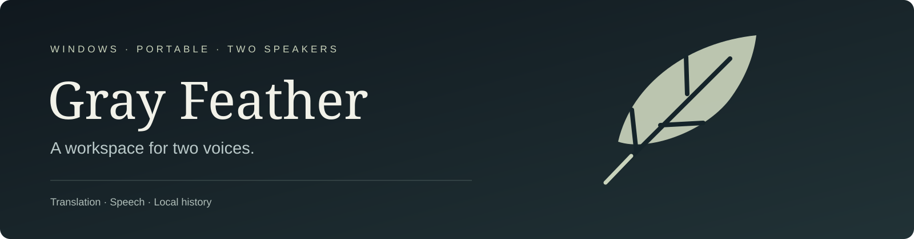

# Gray Feather

**Two speakers. Free translation. One portable Windows workspace.**

[Download](https://github.com/leon-executes/Gray-Feather/releases/latest) · [Dependencies](DEPENDENCIES.md) · [Manual](docs/MANUAL.md) · [Build](BUILD.md) · [Licence](LICENSE)

<!-- Banner slot: replace assets/banner.svg with your final wide artwork. See assets/README.md. -->
 

## Run

1. Download **GrayFeather-1.3.0-GitHub-Windows-x64.zip** from Releases. GitHub's automatic **Source code** download is for developers.
2. Extract it to a writable folder. Keep `_internal`, `licenses` and the other supplied folders beside `GrayFeather.exe`.
3. Open **GrayFeather.exe**. Choose both languages. Press **Record Speech**, speak, then **Stop recording**.
4. The app finishes transcription, translates and reads the result when **Voice Enabled** is selected. Or type and press **Translate →**.

Windows 10 version 1903+ or Windows 11, x64. No Python, browser, WebView2, Docker or model installer required. The release is unsigned. Automatic translation uses the internet; **Index 2B · offline AI** is an explicit local option. See [dependencies and language coverage](DEPENDENCIES.md).

## Use

| Control | What it does |
| --- | --- |
| **Record Speech** | Live previews while speaking; one final result when recording stops. |
| **Review** | Inspect alternatives and backtranslation. Add another available opinion. |
| **Listen / Halt Voice** | Read the result again or stop playback. |
| **Voice Enabled / Disabled** | Control automatic reading. |
| **Clear Session** | Start fresh; the previous session remains in Saved sessions. |
| **Export** | Save DOCX, TXT, CSV or JSON. Word is not required. |
| **Settings / Manual** | Change settings immediately or read short usage tips. |

**Ctrl+Enter:** translate · **Esc:** cancel/stop voice · **Ctrl+Shift+E:** export · **Ctrl+,** settings.

History lives in `GrayFeather-data` beside the executable. **Close the app and keep that folder when upgrading.** See [data, backup and privacy](docs/PRIVACY.md). Free services can throttle or fail. Language support differs between text, dictation and voice; [coverage table](APP-CAPABILITIES.csv).

## Build

Use **CPython 3.12 x64**. Restore the pinned resource packs, then run `build.ps1`. The exact commands, asset downloads and verification steps are in [BUILD.md](BUILD.md). Dependencies are pinned in [requirements-build.txt](requirements-build.txt).

## What makes it different

Gray Feather keeps each person's original words and translated result together. Translation, speech recognition and playback have separate routing policies. The app compares complete available translations, checks selected consequential details, and applies bounded source-based repairs before presenting the final result. It preserves originals and alternatives rather than constructing a sentence from unrelated engine fragments.

The desktop workflow also includes cancellable speech previews, prepared voice reserves, durable local history, Unicode/RTL export and a bundled offline translation option. Native runtimes and model weights ship with the portable download. No local web server or background updater is needed.

These mechanisms reduce specific failure modes; they do not guarantee meaning or equal accuracy across languages. The [architecture](docs/ARCHITECTURE.md) explains the implementation. The [verification notes](docs/VERIFICATION.md) distinguish software checks from translation-quality evidence and document remaining limits.

## Licence and author

Created by **[Parham (Leon) Faraji](https://github.com/leon-executes)**, from [Forumark's creators](https://forumark.com).

Gray Feather's original code and documentation are **source-available under [PolyForm Noncommercial 1.0.0](LICENSE)**. The full licence defines permitted purposes, including its provisions for noncommercial organizations. For uses outside those permissions, contact the author through the GitHub profile. Third-party code, runtimes, models and datasets retain their [own licences](THIRD-PARTY-NOTICES.md).
